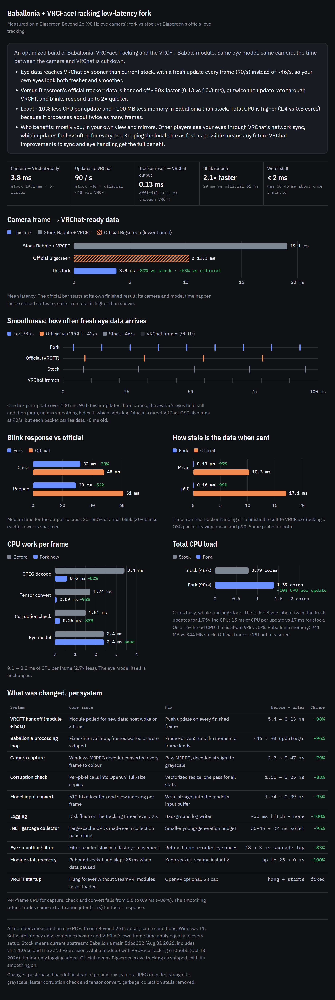

# Baballonia + VRCFaceTracking low-latency fork

[](https://github.com/Encapsulation/baballonia-vrcft-lowlatency/stargazers)

Faster eye tracking for VRChat: same Baballonia eye model and camera, much less delay between the camera and VRChat. Tested on a Bigscreen Beyond 2e.



## Install

1. Download `BaballoniaVRCFT-LowLatency.zip` from the [latest release](https://github.com/Encapsulation/baballonia-vrcft-lowlatency/releases/latest) and extract it, for example to `C:\BabVRCFT`. It contains the prebuilt apps and the full source.
2. Close Baballonia and VRCFaceTracking.
3. Double-click one of these:
   - **`BUILD-AND-INSTALL.cmd`**: builds everything from source on your PC, then installs it. It takes 10 to 20 minutes, needs about 10 GB free on C:, and needs no git, Visual Studio or admin rights.
   - **`INSTALL-PREBUILT.cmd`**: installs the included prebuilt apps in about a minute.
4. Start **VRCFaceTracking**, then **Baballonia**, from the Start menu ("... (Low Latency)").

Your existing calibration and models are kept. The installer sets the Bigeye capture mode to **Lowest Latency**.

## What changed

- **Push handoff:** VRCFT gets each frame the moment it is ready, instead of polling for it.
- **Frame-driven processing:** every camera frame is processed, 90 per second.
- **Camera capture:** the raw camera JPEG is decoded straight to grayscale.
- **Hot path:** faster corruption check and model-input conversion.
- **Stalls removed:** logging moved off the tracking thread, and garbage-collection stalls removed.

## Caveats

- **Who benefits:** the gain is in your own view and mirrors. Other players see your eyes through VRChat's network sync, which updates less often for everyone.
- **CPU:** total CPU is somewhat higher than stock, because it processes about twice as many frames.
- **Status:** unofficial, and not affiliated with Project Babble, VRCFaceTracking or Bigscreen.

## Building from the patches

The `patches/` folder applies on top of upstream Baballonia (`234a393`) and VRCFaceTracking (`09539ec`). One command clones, patches and builds:

```powershell
powershell -NoProfile -ExecutionPolicy Bypass -File .\scripts\setup-clean-exact.ps1 -Build
```

## License

Baballonia: Babble Software Distribution License. VRCFaceTracking: Apache-2.0. Patches and scripts: MIT.
